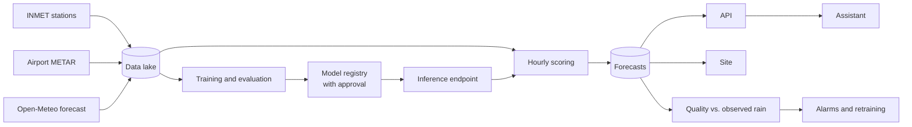

# chuva-bh

**English** · [Português](README.pt-BR.md)

Short-range rain forecasts for Belo Horizonte, Brazil, point by point, with a probability you
can take seriously: every number is later checked against what the rain gauge measured.

**Site:** https://d1jy1a0ip4ajks.cloudfront.net (Portuguese)

## What it is for

A regular weather forecast answers "will it rain tomorrow?" well. For short-term decisions —
cycling now, covering a construction site, postponing an outdoor event, rerouting a delivery —
it says little: it covers a whole day and a whole city.

chuva-bh answers a narrower question that is more useful in those moments:

> What is the chance of at least 0.5 mm of rain at this point, in this hour, 1, 3 or 6 hours from now?

It combines three sources. The weather station gives the current state of the weather. The
airport reports whether it is already raining or thundering. Numerical weather prediction
(NWP) shows where the atmosphere is heading. A model trained on local history since 2021 merges
these sources into a calibrated probability: when the model says 30%, it rained in about 3 out
of 10 similar situations.

Three things make the system trustworthy:

- **It measures itself.** Every issued forecast is compared with the observed rain and with a
  simple reference, persistence. If the model is worse than persistence for a week, an alarm
  fires and retraining starts automatically.
- **It is honest about uncertainty.** A 2% probability on a dry November morning and 60% on a
  convective afternoon are reported as such, not collapsed into "sun" or "rain".
- **It explains what it predicts.** An assistant answers questions in Portuguese such as
  "will it rain in Pampulha at 6 pm?" with the forecast number and what it means.

## How to use it

### Site

The public page shows, for each monitored point, the rain probability for the three forecast
hours, the issue time and the model version. It is refreshed every hour.

The assistant chat is on the same page and requires login. Access is by invitation: the
administrator creates the user, who receives a temporary password by e-mail.

### Assistant

The assistant queries the forecast, the list of points and a knowledge base with the glossary
and reading guidance. It answers in Brasília time, refuses off-topic questions and always
reminds the user that the forecast does not replace official alerts.

```bash
uv run python scripts/genai_ops.py ask "Vai chover na Pampulha nas próximas horas?"
```

### API

For integration with other systems there is an HTTP API with IAM authentication (SigV4):

| Route | Response |
|---|---|
| `GET /points` | Monitored points, with code, name and coordinates |
| `GET /forecast?point=A521` | Latest forecast for the point: issue time, model version and probability per horizon |

## How to read a forecast

Each number is the chance of **at least 0.5 mm of rain in one specific hour**, measured at the
station's rain gauge. A forecast issued at 10:00 (Brasília time) contains:

| Horizon | Hour it refers to |
|---|---|
| 1 h | 10:00–11:00 |
| 3 h | 12:00–13:00 |
| 6 h | 15:00–16:00 |

To avoid misreading it:

- **It is not an accumulation.** The chance of rain at some point in the next six hours is
  higher than any of the three numbers.
- **Compare it with the normal for the season and hour.** In Pampulha, in November, 2–3% of
  morning hours have rain; between 18:00 and 23:00, 10–11%. A 1.5% forecast at 10:00 says the
  morning is drier than usual.
- **0.5 mm is light rain.** The system does not say how much it will rain or over which area.

### How far to trust it

In the test year (2025), the production model's probabilities stayed close to the observed
rain frequency:

| The model said | It actually rained | Hours evaluated |
|---|---|---|
| about 1% | 0.9% | 23,558 |
| about 14% | 10% | 1,212 |
| about 25% | 19% | 656 |
| about 35% | 30% | 449 |
| about 54% | 66% | 87 |

Used as an alert from 20% upwards, it catches 57% of rainy hours, and 7 out of 10 alerts are
false. That is the reality of a hard problem: summer showers form and die within minutes, a few
kilometres apart.

## Performance

The model is compared with two calibrated references over the same period. **Persistence**
assumes the next hour will be like the current one. **NWP** is the Open-Meteo forecast,
converted into a probability. Metrics are for 2025, which was held out from training.

| Evaluation set | Predictor | Brier (lower is better) | PR-AUC (higher is better) |
|---|---|---:|---:|
| Four points | Persistence | 0.0239 | 0.159 |
| | NWP | 0.0242 | 0.157 |
| | Model with the INMET station | **0.0211** | **0.367** |
| Pampulha, METAR period | Persistence | 0.0255 | 0.155 |
| | NWP | 0.0253 | 0.162 |
| | Model with the airport METAR | **0.0225** | **0.357** |

On both sets the Brier improvement over the best reference is 11–12%.

> **Important caveat: these numbers are optimistic.** The NWP features (`fc_*`) come from the
> Open-Meteo Historical Forecast API, which stitches successive model runs together without
> reporting their issue time. For the 3 h and 6 h horizons, some of those values come from runs
> issued *after* the forecast time, which would not be available in production
> ([ADR-009](docs/adr/009-vazamento-na-previsao-historica.md)). The production model (METAR
> mode) also uses these features. Without them (the `obs_only` feature set: observations and
> calendar only), the Brier improvement over the best reference drops to **2.8%** (Brier 0.0232,
> PR-AUC 0.271) on the four points and to 0.8% in Pampulha. The NWP baseline uses the same
> series, so the model-vs-baseline comparison is like for like, but the absolute numbers are not
> what a leakage-free system would achieve. Hourly ingestion already stores every run with its
> `issued_at`; retraining on runs issued at or before the forecast time, which removes the
> leakage, is planned once a few months of that series are available.

PR-AUC, which measures how well rainy hours are ranked at the top, falls with lead time: in the
production model it goes from 0.48 at 1 hour to 0.27 at 6 hours. Details in
[docs/evaluation.md](docs/evaluation.md) and in the [model card](docs/model-card.md).

## How it works



Every hour, in sequence:

| Minute | Step |
|---|---|
| 5 | Collects the new NWP run, the METAR and, when available, the station observation |
| 20 | Builds the hour's features, calls the model and stores the probability per horizon |
| 30 | Publishes the forecasts on the site |
| 40 | Compares expired forecasts with measured rain and publishes quality metrics |

Once a day the system compares the distribution of observed features with the training period
(PSI). A large shift raises an alert.

### Data

| Source | Used for | Update |
|---|---|---|
| INMET automatic stations (Pampulha, Santo Agostinho, Florestal, Sete Lagoas) | Measured rain, which is what the model learns to predict, and the weather state at the station | Monthly historical archive; hourly data through the INMET API |
| METAR from Pampulha airport (SBBH) | Temperature, humidity, pressure, wind, cloud ceiling and ongoing rain or thunder | Hourly |
| Open-Meteo NWP (CC BY 4.0 license) | Forecast rain, clouds, humidity and CAPE for each horizon | Hourly |

### Model

A single XGBoost for the three horizons (the horizon is a feature), with 25 to 28 features
depending on the mode:

- recent and accumulated rain;
- pressure tendency;
- temperature–dew point spread;
- wind and cloud ceiling;
- hour of day and time of year;
- NWP forecast for the target hour.

Training is temporal: up to 2023 to learn, 2024 to tune and 2025 to evaluate.

A trained version only enters the registry if it beats the references on Brier, and it only
goes to production after manual approval. Approval swaps the endpoint model automatically.

The system has two operating modes, depending on the real-time source available:

- **Full mode:** uses the INMET stations' hourly observations and covers the four points.
- **METAR mode:** uses the airport report instead of the station and covers Pampulha, with
  performance close to full mode. This is the mode running today, while access to the INMET
  hourly API is pending.

### Assistant

A LangGraph agent with three read-only tools: forecast, list of points, and search over a
knowledge base containing the glossary, the reading guide and the model card. A guardrail
filters inappropriate content, prompt-manipulation attempts and personal data. It is evaluated
on 36 reference questions: it chose the right tool in 89% of them and had a faithfulness of
0.96 to the sources ([docs/agent-evaluation.md](docs/agent-evaluation.md)).

## Security and privacy

- Each component has its own permissions, restricted to what it uses.
- Data is encrypted with a project key, and buckets have no public access.
- The site is served over HTTPS only, with a content policy that blocks third-party scripts.
- The API requires request signing, and the chat requires login.
- Questions asked in the chat are not written to application logs.
- Every infrastructure change is recorded in the audit trail
  ([docs/cloudtrail-audit.md](docs/cloudtrail-audit.md)).
- A budget with e-mail alerts and an automatic block on creating resources protects against
  unexpected spend.

## Operations

Infrastructure is code (AWS CDK, Python), in seven stacks:

| Stack | Contents |
|---|---|
| `foundation` | Encryption key, buckets, audit trail, budget |
| `ingestion` | Hourly collection, catalog and data-lake SQL queries |
| `ml` | Training permissions and model registry |
| `serving` | Hourly scoring, forecast table, API and model deployment |
| `genai` | Knowledge base, guardrail, prompt and assistant |
| `observability` | Quality, drift, dashboard, alarms and retraining |
| `web` | Site, login and chat |

Day-to-day tasks:

```bash
# historical load (stations, NWP and METAR)
uv run python scripts/backfill.py
uv run python scripts/backfill.py --dataset observations --start-year 2026   # monthly update

# training
uv run python scripts/train_local.py                      # local experiment
uv run python scripts/sagemaker_jobs.py start             # pipeline, full mode
uv run python scripts/sagemaker_jobs.py start --feature-set metar
uv run python scripts/explain.py --model-package-arn ARN --test S3_URI   # SHAP

# assistant
uv run python scripts/genai_ops.py sync-kb                # reindex the knowledge base
uv run python eval/run_eval.py                            # evaluation on the reference questions

# site
uv run python scripts/web_ops.py deploy-site
uv run python scripts/web_ops.py create-user --email person@example.com

# cleanup and cost
uv run python scripts/ttl_sweeper.py --yes                # delete expired temporary resources
uv run python scripts/teardown.py --phase 6 --dry-run     # list what would be removed from a stack
uv run python scripts/cost_report.py
```

Deployment configuration comes from the environment and never goes into Git
([.env.example](.env.example)):

| Variable | Purpose |
|---|---|
| `CHUVA_BUDGET_EMAIL` | Receives cost alerts and system alarms |
| `CHUVA_KILL_SWITCH_ROLES` | Roles that lose permission to create expensive resources when the budget is reached |
| `CHUVA_KILL_SWITCH_USERS` | IAM users under the same rule |

## Development

Requirements: Python 3.12 with [uv](https://docs.astral.sh/uv/), Node.js 24 and AWS CLI v2.

```bash
uv sync
npm ci
uv run pre-commit install

uv run ruff check .
uv run ruff format --check .
uv run mypy
uv run pytest
npx cdk synth --quiet
```

Tests do not touch AWS: services are mocked with `moto` and external calls with synthetic
responses. CI runs the same commands on every push, with an 80% coverage gate.

| Folder | Contents |
|---|---|
| `src/ingestion` | Source clients, validation and data-lake writes |
| `src/features` | Model features, identical in training and scoring |
| `src/training` | Preprocessing, metrics, baselines and training pipeline |
| `src/serving` | Hourly scoring, API and model deployment |
| `src/agent` | Assistant, tools and evaluation |
| `src/monitoring` | Quality and drift |
| `src/web` and `web/` | Site backend and pages |
| `infra/` | CDK stacks |
| `scripts/` | Operations |

## Documentation (Portuguese)

- [Architecture and the life of a forecast](docs/architecture.md)
- [Model card](docs/model-card.md) and [explainability](docs/explainability.md)
- [Model evaluation](docs/evaluation.md) and [assistant evaluation](docs/agent-evaluation.md)
- [Data quality](docs/data-quality.md) and [SQL queries](docs/athena-queries.md)
- [Architecture decision records](docs/adr/README.md)

## Disclaimer

Experimental forecast. It does not replace alerts from Belo Horizonte's Civil Defense or INMET
warnings. In case of flooding or landslide risk, always follow official guidance.

NWP data: [Open-Meteo](https://open-meteo.com), under the CC BY 4.0 license. Station data:
Instituto Nacional de Meteorologia (INMET). METAR reports: Aviation Weather Center and Iowa
Environmental Mesonet.

## License

Code released under the [MIT License](LICENSE).
