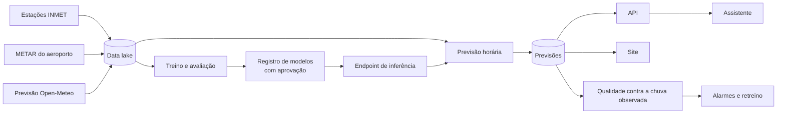

# chuva-bh

[English](README.md) · **Português**

Previsão de chuva para as próximas horas em Belo Horizonte, ponto a ponto, com uma
probabilidade que se pode levar a sério: cada número é conferido depois contra o que o
pluviômetro mediu.

**Site:** https://d1jy1a0ip4ajks.cloudfront.net

## Para que serve

A previsão do tempo comum responde bem a "vai chover amanhã?". Para decisões de curto prazo,
como sair agora de bicicleta, cobrir uma obra, adiar um evento ao ar livre ou mudar uma rota
de entrega, ela diz pouco: fala de um dia inteiro e de uma cidade inteira.

O chuva-bh responde a uma pergunta mais estreita e mais útil nessas horas:

> Qual a chance de chover pelo menos 0,5 mm neste ponto, nesta hora, daqui a 1, 3 ou 6 horas?

Para isso ele combina três fontes. A estação meteorológica dá o estado do tempo agora. O
aeroporto informa se já está chovendo ou trovejando. A previsão numérica mostra para onde a
atmosfera caminha. Um modelo treinado com o histórico local desde 2021 junta essas fontes em
uma probabilidade calibrada. Quando o modelo diz 30%, choveu em cerca de 3 de cada 10
situações parecidas.

Três pontos fazem o sistema confiável:

- **Ele mede a si mesmo.** Toda previsão emitida é comparada com a chuva observada e com uma
  referência simples, a persistência. Se o modelo ficar pior que ela por uma semana, um alarme
  dispara e um novo treino começa sozinho.
- **Ele é honesto sobre a incerteza.** Uma probabilidade de 2% numa manhã seca de novembro e
  uma de 60% numa tarde de convecção são tratadas como o que são, sem virar "sol" ou "chuva".
- **Ele explica o que prevê.** Um assistente responde em português a perguntas como "vai
  chover na Pampulha às 18h?" com o número da previsão e o significado dele.

## Como usar

### Site

A página pública mostra, para cada ponto monitorado, a probabilidade de chuva nas três
horas previstas, o horário de emissão e a versão do modelo. Ela é atualizada a cada hora.

O chat com o assistente fica na mesma página e exige login. O acesso é por convite: quem
administra o sistema cria o usuário, e a pessoa recebe uma senha temporária por e-mail.

### Assistente

O assistente consulta a previsão, a lista de pontos e uma base com o glossário e as
orientações de leitura. Ele responde em hora de Brasília, recusa perguntas fora do tema e
sempre lembra que a previsão não substitui os alertas oficiais.

```bash
uv run python scripts/genai_ops.py ask "Vai chover na Pampulha nas próximas horas?"
```

### API

Para integrar com outros sistemas, há uma API HTTP com autenticação IAM (SigV4):

| Rota | Resposta |
|---|---|
| `GET /points` | Pontos monitorados, com código, nome e coordenadas |
| `GET /forecast?point=A521` | Última previsão do ponto: horário de emissão, versão do modelo e probabilidade por horizonte |

## Como ler uma previsão

Cada número é a chance de chover **pelo menos 0,5 mm numa hora específica**, medida no
pluviômetro da estação. Uma previsão emitida às 10h (hora de Brasília) traz:

| Horizonte | Hora a que se refere |
|---|---|
| 1 h | entre 10h e 11h |
| 3 h | entre 12h e 13h |
| 6 h | entre 15h e 16h |

Alguns cuidados para não ler errado:

- **Não é um acumulado.** A chance de chover em algum momento das próximas seis horas é
  maior que qualquer um dos três números.
- **Compare com o normal da época e da hora.** Na Pampulha, em novembro, de 2% a 3% das
  horas da manhã têm chuva; entre 18h e 23h, de 10% a 11%. Uma previsão de 1,5% às 10h diz que
  a manhã está mais seca que o habitual.
- **0,5 mm é chuva fraca.** O sistema não diz quanto vai chover nem a área atingida.

### Quanto dá para confiar

No ano de teste (2025), as probabilidades do modelo em produção ficaram próximas da
frequência real de chuva:

| O modelo disse | Choveu de fato | Horas avaliadas |
|---|---|---|
| cerca de 1% | 0,9% | 23.558 |
| cerca de 14% | 10% | 1.212 |
| cerca de 25% | 19% | 656 |
| cerca de 35% | 30% | 449 |
| cerca de 54% | 66% | 87 |

Usado como alerta a partir de 20%, ele pega 57% das horas com chuva, e 7 de cada 10 alertas
são falsos. É o retrato de um problema difícil: pancadas de verão nascem e morrem em
minutos, a poucos quilômetros umas das outras.

## Desempenho

O modelo é comparado com duas referências calibradas no mesmo período. A **persistência**
supõe que a próxima hora será como a atual. A **previsão numérica** é a da Open-Meteo,
convertida em probabilidade. As métricas são do ano de 2025, que ficou fora do treino.

| Conjunto avaliado | Preditor | Brier (menor é melhor) | PR-AUC (maior é melhor) |
|---|---|---:|---:|
| Quatro pontos | Persistência | 0,0239 | 0,159 |
| | Previsão numérica | 0,0242 | 0,157 |
| | Modelo com a estação do INMET | **0,0211** | **0,367** |
| Pampulha, período com METAR | Persistência | 0,0255 | 0,155 |
| | Previsão numérica | 0,0253 | 0,162 |
| | Modelo com o METAR do aeroporto | **0,0225** | **0,357** |

Nos dois conjuntos, o ganho no Brier fica entre 11% e 12% sobre a melhor referência.

> **Ressalva importante: esses números são otimistas.** As variáveis de previsão numérica
> (`fc_*`) vêm da Historical Forecast API da Open-Meteo, que monta a série com rodadas
> sucessivas sem informar a hora de emissão. Para 3 h e 6 h, parte desses valores vem de
> rodadas emitidas *depois* do momento da previsão, o que não estaria disponível em produção
> ([ADR-009](docs/adr/009-vazamento-na-previsao-historica.md)). O modelo em produção (modo
> METAR) também usa essas variáveis. Sem elas (conjunto `obs_only`, só observações e
> calendário), o ganho no Brier sobre a melhor referência cai para **2,8%** (Brier 0,0232,
> PR-AUC 0,271) nos quatro pontos e para 0,8% na Pampulha. A ingestão horária já grava cada
> rodada com `issued_at`; o retreino só com rodadas emitidas até o instante da previsão, que
> elimina o vazamento, está planejado para quando houver alguns meses dessa série. O PR-AUC,
que mede a capacidade de pôr as horas de chuva no topo, cai com a antecedência. No modelo em
produção, ele vai de 0,48 em 1 hora a 0,27 em 6 horas.
Detalhes em [docs/evaluation.md](docs/evaluation.md) e no
[model card](docs/model-card.md).

## Como funciona



Toda hora, em sequência:

| Minuto | Etapa |
|---|---|
| 5 | Coleta a rodada nova da previsão numérica, o METAR e, quando disponível, a observação da estação |
| 20 | Monta as variáveis da hora, chama o modelo e grava a probabilidade por horizonte |
| 30 | Publica as previsões no site |
| 40 | Compara as previsões vencidas com a chuva medida e publica as métricas de qualidade |

Uma vez por dia, o sistema compara a distribuição das variáveis observadas com a do período
de treino (PSI). Desvio grande gera alerta.

### Dados

| Fonte | Para que é usada | Atualização |
|---|---|---|
| Estações automáticas do INMET (Pampulha, Santo Agostinho, Florestal, Sete Lagoas) | Chuva medida, que é o que o modelo aprende a prever, e o estado do tempo na estação | Arquivo histórico mensal; dado horário pela API do INMET |
| METAR do aeroporto da Pampulha (SBBH) | Temperatura, umidade, pressão, vento, teto de nuvens e chuva ou trovoada em curso | Horária |
| Open-Meteo, previsão numérica (licença CC BY 4.0) | Chuva, nuvens, umidade e CAPE previstos para cada horizonte | Horária |

### Modelo

Um XGBoost único para os três horizontes, com 25 a 28 variáveis, conforme o modo:

- chuva recente e acumulada;
- tendência de pressão;
- diferença entre temperatura e ponto de orvalho;
- vento e teto de nuvens;
- hora do dia e época do ano;
- previsão numérica para a hora alvo.

O treino é temporal: até 2023 para aprender, 2024 para ajustar e 2025 para avaliar.

Cada versão treinada só entra no registro se superar as referências no Brier, e só vai para
produção depois de aprovação manual. A aprovação troca o modelo do endpoint
automaticamente.

O sistema tem dois modos de operação, que dependem da fonte disponível em tempo real:

- **Modo completo:** usa a observação horária das estações do INMET e cobre os quatro pontos.
- **Modo METAR:** usa o boletim do aeroporto no lugar da estação e cobre a Pampulha, com
  desempenho quase igual ao modo completo. É o modo em operação hoje, enquanto o acesso à
  API horária do INMET não é liberado.

### Assistente

Um agente LangGraph com três ferramentas, todas só de leitura: previsão, lista de pontos e
busca numa base de conhecimento com o glossário, o guia de leitura e o model card. Um
guardrail filtra conteúdo impróprio, tentativas de manipular o prompt e dados pessoais. Ele
é avaliado com 36 perguntas de referência: escolheu a ferramenta certa em 89% delas e teve
fidelidade de 0,96 às fontes ([docs/agent-evaluation.md](docs/agent-evaluation.md)).

## Segurança e privacidade

- Cada componente tem a própria permissão, restrita ao que ele usa.
- Os dados ficam criptografados com uma chave do projeto, e os buckets não têm acesso público.
- O site é servido só por HTTPS, com política de conteúdo que bloqueia scripts de terceiros.
- A API exige assinatura, e o chat exige login.
- As perguntas feitas no chat não são gravadas nos logs da aplicação.
- Toda alteração na infraestrutura fica registrada na trilha de auditoria
  ([docs/cloudtrail-audit.md](docs/cloudtrail-audit.md)).
- Um orçamento com alertas por e-mail e bloqueio automático de criação de recursos protege
  contra gasto inesperado.

## Operação

A infraestrutura é código (AWS CDK, Python), em sete stacks:

| Stack | O que contém |
|---|---|
| `foundation` | Chave de criptografia, buckets, trilha de auditoria, orçamento |
| `ingestion` | Coleta horária, catálogo e consultas SQL do data lake |
| `ml` | Permissões de treino e registro de modelos |
| `serving` | Previsão horária, tabela de previsões, API e deploy de modelos |
| `genai` | Base de conhecimento, guardrail, prompt e assistente |
| `observability` | Qualidade, drift, painel, alarmes e retreino |
| `web` | Site, login e chat |

Tarefas do dia a dia:

```bash
# carga do histórico (estações, previsão numérica e METAR)
uv run python scripts/backfill.py
uv run python scripts/backfill.py --dataset observations --start-year 2026   # atualização mensal

# treino
uv run python scripts/train_local.py                      # experimento local
uv run python scripts/sagemaker_jobs.py start             # pipeline, modo completo
uv run python scripts/sagemaker_jobs.py start --feature-set metar
uv run python scripts/explain.py --model-package-arn ARN --test S3_URI   # SHAP

# assistente
uv run python scripts/genai_ops.py sync-kb                # reindexa a base de conhecimento
uv run python eval/run_eval.py                            # avaliação com as perguntas de referência

# site
uv run python scripts/web_ops.py deploy-site
uv run python scripts/web_ops.py create-user --email pessoa@exemplo.com

# limpeza e custo
uv run python scripts/ttl_sweeper.py --yes                # apaga recursos temporários vencidos
uv run python scripts/teardown.py --phase 6 --dry-run     # lista o que seria removido de uma stack
uv run python scripts/cost_report.py
```

A configuração de deploy vem do ambiente e nunca vai para o Git
([.env.example](.env.example)):

| Variável | Uso |
|---|---|
| `CHUVA_BUDGET_EMAIL` | Recebe os alertas de custo e os alarmes do sistema |
| `CHUVA_KILL_SWITCH_ROLES` | Roles que perdem a permissão de criar recursos caros quando o orçamento é atingido |
| `CHUVA_KILL_SWITCH_USERS` | Usuários IAM com a mesma regra |

## Desenvolvimento

Requisitos: Python 3.12 com [uv](https://docs.astral.sh/uv/), Node.js 24 e AWS CLI v2.

```bash
uv sync
npm ci
uv run pre-commit install

uv run ruff check .
uv run ruff format --check .
uv run mypy
uv run pytest
npx cdk synth --quiet
```

Os testes não acessam a AWS: os serviços são simulados com `moto` e as chamadas externas
com respostas sintéticas. O CI roda os mesmos comandos a cada push.

| Pasta | Conteúdo |
|---|---|
| `src/ingestion` | Clientes das fontes, validação e escrita no data lake |
| `src/features` | Variáveis do modelo, as mesmas no treino e na previsão |
| `src/training` | Preparação, métricas, referências e pipeline de treino |
| `src/serving` | Previsão horária, API e deploy de modelos |
| `src/agent` | Assistente, ferramentas e avaliação |
| `src/monitoring` | Qualidade e drift |
| `src/web` e `web/` | Backend e páginas do site |
| `infra/` | Stacks do CDK |
| `scripts/` | Operação |

## Documentação

- [Arquitetura e fluxo de uma previsão](docs/architecture.md)
- [Model card](docs/model-card.md) e [explicabilidade](docs/explainability.md)
- [Avaliação do modelo](docs/evaluation.md) e [do assistente](docs/agent-evaluation.md)
- [Qualidade dos dados](docs/data-quality.md) e [consultas SQL](docs/athena-queries.md)
- [Decisões de arquitetura](docs/adr/README.md)

## Aviso

Previsão experimental. Não substitui os alertas da Defesa Civil de Belo Horizonte nem os
avisos do INMET. Em risco de alagamento ou deslizamento, siga sempre as orientações oficiais.

Dados de previsão numérica: [Open-Meteo](https://open-meteo.com), sob licença CC BY 4.0.
Dados de estações: Instituto Nacional de Meteorologia (INMET). Boletins METAR: Aviation
Weather Center e Iowa Environmental Mesonet.

## Licença

Código sob a [licença MIT](LICENSE).
