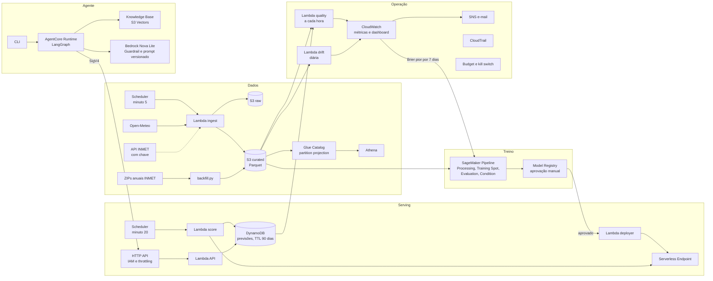

# Arquitetura

Tudo roda em `us-east-2`, sem VPC permanente nem NAT, e é criado pelo CDK em seis stacks:
`foundation`, `ingestion`, `ml`, `serving`, `genai` e `observability`.

## Fluxo de uma previsão

1. No minuto 5 de cada hora, a ingestão grava a rodada da Open-Meteo e, com a chave do INMET, a
   observação da hora. Os objetos têm chave determinística, então uma nova tentativa sobrescreve.
2. No minuto 20, o scoring lê a configuração do modelo ativo no SSM, monta as features da hora,
   chama o endpoint e grava uma linha por horizonte no DynamoDB.
3. O agente consulta a API assinada com SigV4 e responde em hora de Brasília.
4. No minuto 40, a Lambda de qualidade compara as previsões já vencidas com a chuva observada.

## Decisões

As decisões estão em `docs/adr/`. As principais: Serverless Inference (ADR-001), S3 Vectors em
vez de OpenSearch Serverless (ADR-002), ground truth nas estações do INMET (ADR-006), região
us-east-2 por causa da SCP da conta (ADR-007) e o vazamento parcial nas features de previsão
histórica (ADR-009).
