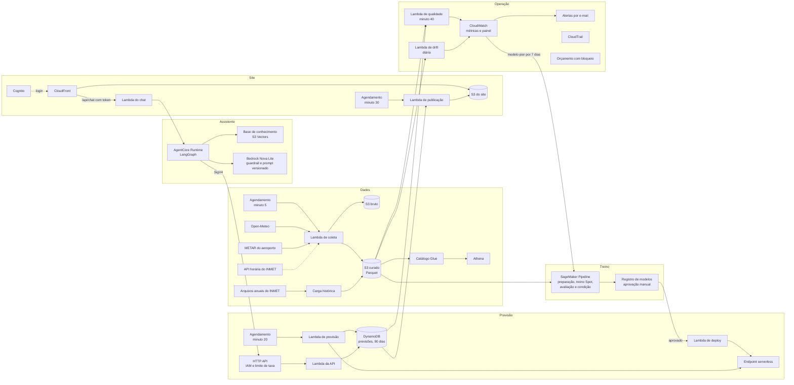

# Arquitetura

O sistema roda na AWS, em `us-east-2`, sem servidores permanentes nem rede privada. Toda a
infraestrutura é criada pelo CDK em sete stacks: `foundation`, `ingestion`, `ml`, `serving`,
`genai`, `observability` e `web`.

## Fluxo de uma previsão

1. **Minuto 5.** A coleta grava a nova rodada da Open-Meteo, o METAR das últimas horas e, quando
   houver acesso, a observação horária das estações do INMET. Cada objeto tem chave
   determinística, então uma nova tentativa só sobrescreve o anterior.
2. **Minuto 20.** A Lambda de previsão lê no SSM qual modelo está ativo e qual conjunto de
   variáveis ele usa. Depois monta as variáveis da hora, chama o endpoint e grava uma linha por
   horizonte no DynamoDB.
3. **Minuto 30.** A publicação gera o `forecasts.json` estático do site.
4. **Minuto 40.** A qualidade compara as previsões já vencidas com a chuva medida.
5. **A qualquer momento.** O assistente consulta a API, assinada com SigV4, e responde em hora
   de Brasília. No site, o chat só funciona com o token do Cognito.

## Modos de operação

O modelo ativo define de onde vem o estado do tempo da hora:

| Modo | Fonte do estado atual | Pontos |
|---|---|---|
| Completo | Observação horária das estações do INMET | Quatro |
| METAR | Boletim do aeroporto da Pampulha | Pampulha |

Trocar de modo é aprovar outra versão no registro de modelos. A Lambda de deploy atualiza o
endpoint e o parâmetro do modelo ativo, e a previsão da hora seguinte já usa o modo novo.

## Decisões

As decisões estão em [docs/adr](adr/README.md). Estas são as que mais definem o desenho:

- endpoint serverless (ADR-001);
- S3 Vectors como base vetorial (ADR-002);
- chuva observada nas estações do INMET como verdade (ADR-006);
- vazamento parcial nas variáveis de previsão histórica (ADR-009);
- deploy do modelo na aprovação (ADR-010);
- modo METAR (ADR-013).
